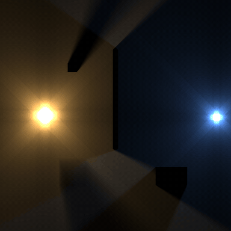
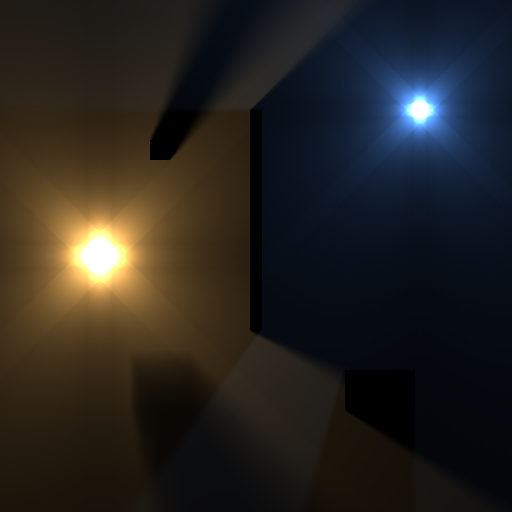
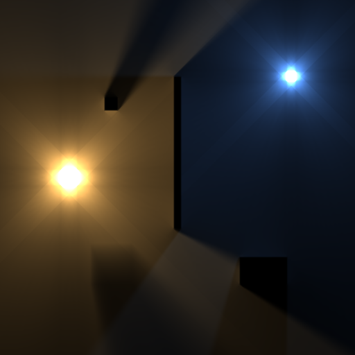

# HRC Global Illumination for Godot 4

Real-time, noise-free 2D global illumination for Godot 4, running fully on the GPU. Implements **Holographic Radiance Cascades** from Freeman, Sannikov & Margel (2025) · [arXiv:2505.02041](https://arxiv.org/abs/2505.02041).



| Direct light | 3 bounces |
| :---: | :---: |
|  |  |

- Sharp, correct shadows and penumbrae from every light, with no noise and no temporal smearing
- Soft lights, translucent media, and multiple light bounces
- ~3 ms per update at 512×512 on a laptop GPU, and nothing at all while the scene is static
- Drop-in nodes: `HRCEmitter`, `HRCOccluder`, `HRCDisplay`

## Requirements

- Godot **4.3 or newer** (tested on **4.5.1**)
- **Forward+** or **Mobile** renderer. The Compatibility renderer has no compute shaders.

## Installation

1. Put this repository at `res://addons/hrc_gi/`. The repo root *is* the add-on folder.
   ```sh
   git clone https://github.com/ppmpreetham/hrc-gi.git addons/hrc_gi
   ```
   You can also download the ZIP and extract it there.
2. If your project uses Compatibility: **Project Settings → Rendering → Renderer → Rendering Method = `forward_plus`**, then **Project → Reload Current Project**.
3. Optional: enable the plugin under **Project Settings → Plugins**. The nodes appear in *Add Child Node* either way.
4. Try `res://addons/hrc_gi/demo/hrc_demo.tscn` (press **F6**). The blue light follows your mouse.

## Quick Start

```
Node2D
├── HRCGlobalIllumination   computes the GI
│   ├── HRCEmitter          light   (direct child)
│   └── HRCOccluder         blocker (direct child)
└── HRCDisplay              shows the result (hrc_node → HRCGlobalIllumination)
```

- The GI grid is the `HRCGlobalIllumination` node's local pixels `(0,0)` to `scene_size`. Emitter and occluder positions and sizes are in those pixels.
- Scale or move the GI node to cover your level. For example, `512×512` at `scale = 1.5` covers 768×768 pixels.
- Give `HRCDisplay` the same position as the GI node and a size of `scene_size × scale`. Or use `gi_texture` directly in a `Sprite2D` or your own shader.
- Everything updates live in the editor as you drag nodes.

## API

### HRCGlobalIllumination (`Node2D`)

| Property | Default | Description |
| --- | --- | --- |
| `scene_size: Vector2i` | `512×512` | GI grid resolution (16–8192 per axis). |
| `gi_bounces: int` | `1` | 1 = direct light. Each extra bounce adds indirect light and costs about one more GI pass. |
| `apply_cross_blur: bool` | `true` | Removes HRC's checkerboard pattern. Leave on. |
| `exposure: float` | `1.0` | Output brightness. Output = fluence · exposure / 2π. |
| `continuous_update: bool` | `false` | Recompute every frame. When off, it recomputes only when something changes. |
| `preview_in_editor: bool` | `true` | Run GI in the editor viewport. |

| Member | Description |
| --- | --- |
| `gi_texture: Texture2DRD` | The result (RGBA16F, `scene_size`). Stays on the GPU and updates in place, so assign it once. `get_image()` works for CPU readback (slow). |
| `signal gi_updated(output_texture: Texture2D)` | Emitted after each recompute. |
| `set_scene_pixel(pos: Vector2i, emission: Color, extinction: float, albedo := Color.BLACK)` | Paint one pixel of a custom layer, for shapes that aren't rectangles. `emission` follows the same rule as `HRCEmitter`. |
| `clear_scene()` | Clear the custom pixel layer. Emitter and occluder nodes are unaffected. |
| `mark_dirty()` | Force a recompute next frame. |

### HRCEmitter (`Node2D`, direct child of the GI node)

| Property | Default | Description |
| --- | --- | --- |
| `emission_color: Color` | white | Light color. |
| `emission_strength: float` | `10.0` | Brightness. A solid emitter's surface radiance is `color × strength`. |
| `extinction: float` | `10.0` | `10` = solid light. `0` = transparent glow that emits `strength` per pixel. |
| `size: Vector2` | `16×16` | Size in GI pixels, centered on the node. |
| `draw_debug: bool` | `false` | Draw the outline at runtime. It's always drawn in the editor. |

### HRCOccluder (`Node2D`, direct child of the GI node)

| Property | Default | Description |
| --- | --- | --- |
| `extinction: float` | `10.0` | Light absorbed **per pixel**: `10` solid, `0.01`–`0.05` glass/fog. It adds up with thickness. |
| `albedo: Color` | grey 0.5 | How much light the surface reflects. Only used when `gi_bounces > 1`. |
| `size: Vector2` | `32×32` | Size in GI pixels, centered on the node. |
| `draw_debug: bool` | `false` | Draw the outline at runtime. |

Moving, editing or hiding an emitter or occluder triggers a recompute automatically. Rotated or scaled nodes use their bounding box.

### HRCDisplay (`TextureRect`)

| Property | Description |
| --- | --- |
| `hrc_node: NodePath` | The `HRCGlobalIllumination` node to show. |
| `blend_mode` | `Mix` shows the light. `Add` adds it to the scene. `Multiply` lights a scene drawn underneath. |

### Examples

```gdscript
# A light that follows the mouse
func _process(_delta):
    $HRCGlobalIllumination/MyLight.position = $HRCGlobalIllumination.get_local_mouse_position()
```

```gdscript
# Paint a round light and a thin wall
func _ready():
    var hrc = $HRCGlobalIllumination
    for y in range(240, 272):
        for x in range(240, 272):
            if Vector2(x - 256, y - 256).length() < 16:
                hrc.set_scene_pixel(Vector2i(x, y), Color(5, 4, 1), 10.0)
    for y in range(150, 350):
        hrc.set_scene_pixel(Vector2i(350, y), Color.BLACK, 10.0)
```

```gdscript
# Use the GI in your own canvas shader
$Level.material.set_shader_parameter("gi", $HRCGlobalIllumination.gi_texture)
```

## Performance

Measured on an RTX 3050 Ti Laptop GPU with Godot 4.5.1, at 512×512:

| `gi_bounces` | GPU time per update |
| --- | --- |
| 1 | ~2.7 ms |
| 3 | ~8.8 ms |

A static scene costs nothing. Halving `scene_size` on each axis and doubling `scale` makes it about 4× cheaper.

## Troubleshooting

| Problem | Fix |
| --- | --- |
| *"compute shaders need the Forward+ or Mobile renderer"*, or blank output | Switch the renderer to Forward+ and reload the project. |
| `HRC: could not load …glsl` | The shaders aren't imported yet. Reload the project. |
| A light or wall does nothing | It must be a **direct child** of the GI node and inside `0..scene_size`. |
| Glass looks solid | Lower `extinction`. It's per pixel. |
| Star-shaped streaks around tiny lights | A known HRC artifact. Make the light a few pixels bigger or raise `scene_size`. |

## How it works

The scene is solved as four 90° quadrants. In each one, short rays are traced and then merged into longer ones (the cascades). Probes thin out only along the direction they look, which keeps shadow edges sharp even for distant lights. The four results are summed and lightly blurred. Light from outside the grid counts as zero, and lighting is diffuse only (no reflections or specular highlights). See the [paper](https://arxiv.org/abs/2505.02041) for details. The shaders cite the equation numbers they implement.

## Credits

Algorithm by **Rouli Freeman** (University of Oxford), **Alexander Sannikov** (Grinding Gear Games), and **Adrian Margel**.
Godot implementation by **Preetham Pemmasani**. MIT License.
