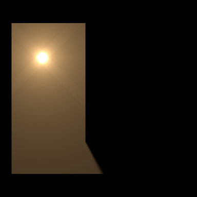
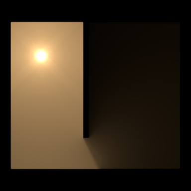
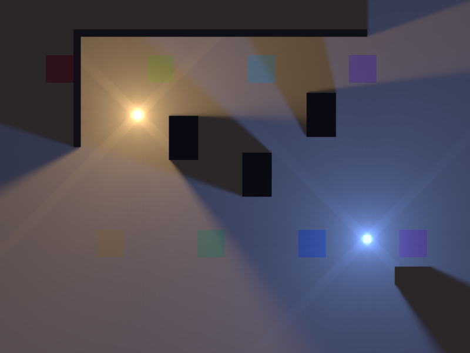
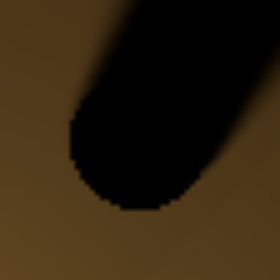
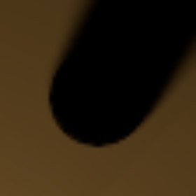
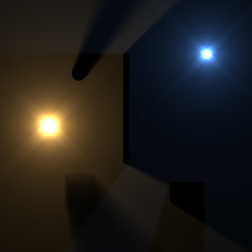
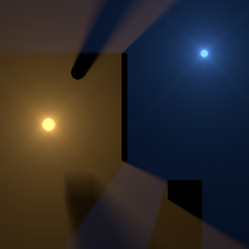

# HRC Global Illumination for Godot 4

Real-time, noise-free 2D global illumination for Godot 4, running fully on the GPU. Implements **Holographic Radiance Cascades** from Freeman, Sannikov & Margel (2025) · [arXiv:2505.02041](https://arxiv.org/abs/2505.02041).


| `gi_bounces = 1` (direct light) | `gi_bounces = 3` |
| :---: | :---: |
|  |  |

- Sharp, correct shadows and soft penumbrae from every light, with no noise and no temporal smearing
- Rectangle and ellipse lights and blockers, translucent materials (glass, fog), and multiple light bounces
- Smooth, anti-aliased edges; objects move smoothly by sub-pixel amounts
- About 3.4 ms per update at 512×512 on a laptop GPU, and nothing at all while the scene is static
- Drop-in nodes: `HRCEmitter`, `HRCOccluder`, `HRCDisplay`

## Requirements

- Godot **4.3 or newer** (tested on **4.5.1**)
- **Forward+** or **Mobile** renderer. The Compatibility renderer has no compute shaders.

## Installation

1. Put this repository at `res://addons/hrc_gi/`. The repo root *is* the add-on folder.
   ```sh
   git clone https://github.com/ppmpreetham/hrc-gi.git addons/hrc_gi
   ```
   You can also download the ZIP and extract it there.
2. If your project uses Compatibility: **Project Settings → Rendering → Renderer → Rendering Method = `forward_plus`**, then **Project → Reload Current Project**. Switching renderer can change how your existing 2D looks. For example, a `WorldEnvironment` glow/bloom that worked in Compatibility did not show up in Forward+ in my test, and turning on *Rendering → Viewport → HDR 2D* did not bring it back and made sprites darker. Check your game after switching.
3. Optional: enable the plugin under **Project Settings → Plugins**. The nodes appear in *Add Child Node* either way.
4. Try `res://addons/hrc_gi/demo/hrc_demo.tscn` (press **F6**). The blue light follows your mouse.

## Quick Start

```
Node2D
├── HRCGlobalIllumination   computes the GI
│   ├── HRCEmitter          light   (direct child)
│   └── HRCOccluder         blocker (direct child)
└── HRCDisplay              shows the result (hrc_node → HRCGlobalIllumination)
```

- The GI grid is the `HRCGlobalIllumination` node's local pixels `(0,0)` to `scene_size`. Emitter and occluder positions and sizes are in those pixels.
- Scale or move the GI node to cover your level. For example, `512×512` at `scale = 1.5` covers 768×768 pixels.
- Give `HRCDisplay` the same position as the GI node and a size of `scene_size × scale`. Or use `gi_texture` directly in a `Sprite2D` or your own shader.
- Everything updates live in the editor as you drag nodes.

## Add it to your own game



You don't have to rebuild anything. HRC only needs to know where your **lights** and **blockers** are.

**1. Install it** (see [Installation](#installation)) and make sure the project uses Forward+ or Mobile.

**2. Add `HRCGlobalIllumination` to your level.** Make it a child of your level's root node and make it cover the area you want lit. For a 1024×768 area:

```
scene_size = 512×384
scale      = (2, 2)
position   = (0, 0)      # top-left of the lit area
```

A smaller `scene_size` is faster and softer. Everything you give HRC is in the GI node's *pixels*, so convert world positions with `hrc.to_local(world_position)`. A node `size` of 8 at `scale = 2` covers 16 screen pixels.

**3. Add lights.** Add an `HRCEmitter` child for each light, then make it follow your game object:

```gdscript
@onready var hrc: HRCGlobalIllumination = $HRCGlobalIllumination
@onready var torch: HRCEmitter = $HRCGlobalIllumination/TorchLight

func _process(_delta):
    torch.position = hrc.to_local($Player.global_position)
```

**4. Add blockers.** Add an `HRCOccluder` for each wall or object that should cast shadows. To mirror things you already have, create them from code. Sprites in a `light_blocker` group:

```gdscript
var _pairs: Array = []   # [[sprite, occluder], ...]

func _ready():
    for sprite: Sprite2D in get_tree().get_nodes_in_group("light_blocker"):
        var occ := HRCOccluder.new()
        hrc.add_child(occ)
        _pairs.append([sprite, occ])

func _process(_delta):
    for p in _pairs:
        var sprite: Sprite2D = p[0]
        var occ: HRCOccluder = p[1]
        occ.position = hrc.to_local(sprite.global_position)
        occ.size = sprite.texture.get_size() * sprite.global_scale / hrc.global_scale
```

Your physics bodies, so shadows match what the player collides with (every `RectangleShape2D` on a `StaticBody2D` or `AnimatableBody2D`):

```gdscript
func add_collision_blockers(root: Node):
    for body in root.find_children("*", "StaticBody2D", true, false):
        for c in body.get_children():
            if c is CollisionShape2D and c.shape is RectangleShape2D:
                var occ := HRCOccluder.new()
                hrc.add_child(occ)
                occ.size = c.shape.size * c.global_scale / hrc.global_scale
                occ.position = hrc.to_local(c.global_position)
```

A `TileMapLayer`, using the bounding box of each tile's collision polygon (tiles without collision are skipped):

```gdscript
func add_tile_blockers(layer: TileMapLayer):
    for cell in layer.get_used_cells():
        var data := layer.get_cell_tile_data(cell)
        if data == null or data.get_collision_polygons_count(0) == 0:
            continue
        var pts := data.get_collision_polygon_points(0, 0)
        var box := Rect2(pts[0], Vector2.ZERO)
        for p in pts:
            box = box.expand(p)
        var occ := HRCOccluder.new()
        hrc.add_child(occ)
        occ.size = box.size * layer.global_scale / hrc.global_scale
        occ.position = hrc.to_local(layer.to_global(layer.map_to_local(cell) + box.get_center()))
```

With the older `TileMap` node, use `tilemap.get_used_cells(0)` and `tilemap.get_cell_tile_data(0, cell)` instead.

Every rectangle is checked for every GI pixel when the scene is baked, so on big maps merge neighbouring tiles into longer rectangles.

**5. Show the light.** Add an `HRCDisplay` after your level art, so it draws on top. Set `hrc_node`, give it the GI node's position, and make its size `scene_size × scale`. Then pick a look:

- **Dark level with glowing lights (recommended):** dim your level art (for example `$Level.modulate = Color(0.2, 0.2, 0.28)`, which acts as ambient light) and set `blend_mode = Add`. Your blockers keep their art.
- **Strict lighting:** `blend_mode = Multiply`. Anything the lights don't reach is black. Solid blockers also render black, so draw them above the `HRCDisplay` (higher `z_index`) if you want to see them.

Use `exposure` on the GI node to make everything brighter or darker.

**Scrolling levels.** The GI grid has to cover what the camera sees: `scene_size × scale` should be at least `viewport size / camera zoom` (add a few pixels of margin). Move the grid with the camera every frame, and **snap it to the GI pixel size**:

```gdscript
func _process(_delta):
    var span := Vector2(hrc.scene_size) * hrc.scale
    var origin := camera.get_screen_center_position() - span / 2.0
    hrc.global_position = origin.snapped(hrc.scale)    # snapped to the GI pixel size
    display.global_position = hrc.global_position
    torch.position = hrc.to_local(player.global_position)
```

Also re-assign each blocker's `position` every frame with `hrc.to_local(world_position)`, because the grid moves under them. Keep your blockers in an array of `[world_position, occluder]` pairs.

- **Why snapping matters.** Without it, every blocker lands at a different sub-pixel spot on the GI grid each frame, so shadow edges shimmer while the camera moves. With snapping, the grid moves in whole GI pixels and blockers stay put relative to it.
- **Why not parent the nodes to the `Camera2D`?** That ignores the camera's smoothing, `offset` and limits. Use `get_screen_center_position()` as above.
- The GI recomputes every frame while things move. When nothing changes, it costs nothing.

## API

### HRCGlobalIllumination (`Node2D`)

| Property | Default | Description |
| --- | --- | --- |
| `scene_size: Vector2i` | `512×512` | GI grid resolution, 16–8192 per axis. Above 2048 needs several GB of VRAM (see [Performance](#performance)). |
| `gi_bounces: int` | `1` | 1 = direct light. Each extra bounce adds indirect light and costs about one more GI pass. |
| `apply_cross_blur: bool` | `true` | Removes HRC's checkerboard pattern. Leave on. |
| `ray_mode` | `Fast` | `Fast` traces only the shortest rays and builds the rest by extension (as in Volumetric-HRC): weaker diagonal streaks around small lights, and up to ~35% faster on small scenes. `Paper` ray-traces the three shortest ray levels exactly as in the paper (slightly more accurate in some tests). |
| `exposure: float` | `1.0` | Output brightness. Output = fluence · exposure / 2π. |
| `gamma_correct: bool` | `true` | Light in linear space: inspector colours are converted from sRGB and the output is sRGB-encoded (skipped automatically with HDR 2D). Off gives the darker, higher-contrast look of v2.0. |
| `anti_aliasing: bool` | `true` | Smooth edges for emitters and occluders, with sub-pixel positions so they move smoothly. Off: shapes snap to whole GI pixels with stepped edges. No measurable cost. |
| `continuous_update: bool` | `false` | Recompute every frame. When off, it recomputes only when something changes. |
| `preview_in_editor: bool` | `true` | Run GI in the editor viewport. |
| `gpu_profiling: bool` | `false` | Measure GPU time per update. Read it with `get_gpu_timings()`. |

| `anti_aliasing = false` | `anti_aliasing = true` | `gamma_correct = false` | `gamma_correct = true` |
| :---: | :---: | :---: | :---: |
|  |  |  |  |

The anti-aliasing images are a 5× close-up of the round blocker in the demo. The gamma images show the whole demo (`exposure` 1.0 without gamma correction, 0.4 with it).

| Member | Description |
| --- | --- |
| `gi_texture: Texture2DRD` | The result (RGBA16F, `scene_size`). Stays on the GPU and updates in place, so assign it once. `get_image()` works for CPU readback (slow). |
| `signal gi_updated(output_texture: Texture2D)` | Emitted after each recompute. |
| `set_scene_pixel(pos: Vector2i, emission: Color, extinction: float, albedo := Color.BLACK)` | Paint one pixel of a custom layer, for shapes that aren't rectangles. `emission` follows the same rule as `HRCEmitter`, but its values are used as linear light (no sRGB conversion), so HDR values like `Color(5, 4, 1)` work. |
| `clear_scene()` | Clear the custom pixel layer. Emitter and occluder nodes are unaffected. |
| `mark_dirty()` | Force a recompute next frame. |
| `get_gpu_timings() -> Dictionary` | With `gpu_profiling` on and a recompute every frame: GPU ms for `bake`, `cascades`, `blur` and `total` of the latest update. |

### HRCEmitter (`Node2D`, direct child of the GI node)

| Property | Default | Description |
| --- | --- | --- |
| `emission_color: Color` | white | Light color. |
| `emission_strength: float` | `10.0` | Brightness. A solid emitter's surface radiance is `color × strength`. |
| `extinction: float` | `10.0` | `10` = solid light. `0` = transparent glow that emits `strength` per pixel. |
| `size: Vector2` | `16×16` | Size in GI pixels, centered on the node. |
| `shape` | `Rectangle` | `Rectangle` or `Ellipse` (fills the size box; equal width and height gives a circle). |
| `draw_debug: bool` | `false` | Draw the outline at runtime. It's always drawn in the editor. |

### HRCOccluder (`Node2D`, direct child of the GI node)

| Property | Default | Description |
| --- | --- | --- |
| `extinction: float` | `10.0` | Light absorbed **per pixel**: `10` solid, `0.01`–`0.05` glass/fog. It adds up with thickness. |
| `albedo: Color` | grey 0.5 | How much light the surface reflects. Only used when `gi_bounces > 1`. |
| `size: Vector2` | `32×32` | Size in GI pixels, centered on the node. |
| `shape` | `Rectangle` | `Rectangle` or `Ellipse`. |
| `draw_debug: bool` | `false` | Draw the outline at runtime. |

Moving, editing, adding, removing or hiding an emitter or occluder triggers a recompute automatically, but only if the scene actually changed. Setting a position to the value it already has costs nothing. Positions and sizes can be fractional: with `anti_aliasing` on (the default), edges are smooth and objects move smoothly instead of snapping to whole GI pixels. Rotated or scaled nodes use their bounding box. For other shapes, paint pixels with `set_scene_pixel()`.

### HRCDisplay (`TextureRect`)

| Property | Description |
| --- | --- |
| `hrc_node: NodePath` | The `HRCGlobalIllumination` node to show. |
| `blend_mode` | `Mix` shows the light. `Add` adds it to the scene. `Multiply` lights a scene drawn underneath. |

### Examples

```gdscript
# A light that follows the mouse
func _process(_delta):
    $HRCGlobalIllumination/MyLight.position = $HRCGlobalIllumination.get_local_mouse_position()
```

```gdscript
# Paint a round light and a thin wall
func _ready():
    var hrc = $HRCGlobalIllumination
    for y in range(240, 272):
        for x in range(240, 272):
            if Vector2(x - 256, y - 256).length() < 16:
                hrc.set_scene_pixel(Vector2i(x, y), Color(5, 4, 1), 10.0)
    for y in range(150, 350):
        hrc.set_scene_pixel(Vector2i(350, y), Color.BLACK, 10.0)
```

```gdscript
# Use the GI in your own canvas shader
$Level.material.set_shader_parameter("gi", $HRCGlobalIllumination.gi_texture)
```

## Performance

GPU time per update with `gi_bounces = 1`, measured with GPU timestamps on an RTX 3050 Ti Laptop GPU (Godot 4.5.1):

| `scene_size` | `ray_mode = Paper` | `ray_mode = Fast` | VRAM (approx.) |
| --- | --- | --- | --- |
| 256×256 | 1.2 ms | 0.8 ms | 35 MB |
| 512×512 | 3.4 ms | 3.4 ms | 140 MB |
| 1024×1024 | 8.6 ms | 8.2 ms | 220 MB |
| 2048×2048 | 60 ms | 56 ms | 900 MB |

- A static scene costs nothing. Each extra bounce costs about one more update.
- Halving `scene_size` on each axis and doubling `scale` makes it 3–4× cheaper.
- Up to about 512×512, each of the four light directions gets its own working textures, so the GPU can process them side by side. That's the extra VRAM at 256–512. Larger scenes are limited by memory bandwidth, so they share one set.
- Measure your own scene with `gpu_profiling = true` and `get_gpu_timings()`.

## Troubleshooting

| Problem | Fix |
| --- | --- |
| *"compute shaders need the Forward+ or Mobile renderer"*, or blank output | Switch the renderer to Forward+ and reload the project. |
| `HRC: could not load …glsl` | The shaders aren't imported yet. Reload the project. |
| A light or wall does nothing | It must be a **direct child** of the GI node and inside `0..scene_size`. |
| Glass looks solid | Lower `extinction`. It's per pixel. |
| Everything is black | With `Multiply`, unlit areas are black. Try `Add` over dimmed art, or raise `exposure`. |
| Shadows are in the wrong place | Positions are in GI pixels. Convert with `hrc.to_local(world_position)`, and check the display has the GI node's position and size `scene_size × scale`. |
| Star-shaped streaks around tiny lights | A known HRC artifact (from the ray directions, not the light's shape). Keep `ray_mode = Fast`, make the light a few pixels bigger, or raise `scene_size`. |
| Light looks washed out or too bright | Lower `exposure` (the demo uses `0.4`), or turn off `gamma_correct` for the older high-contrast look. |
| Light or shadow edges look pixelated | The light is computed at `scene_size`, so each GI pixel covers `scale` screen pixels. Show it with linear filtering (`HRCDisplay` does this unless you pick another filter on it; with `gi_texture` in your own sprite or shader, set its texture filter to Linear). Raise `scene_size` for sharper detail. |

## How it works

The scene is solved as four 90° quadrants. In each one, short rays are traced and then merged into longer ones (the cascades). Probes thin out only along the direction they look, which keeps shadow edges sharp even for distant lights. The four results are summed and lightly blurred. Light from outside the grid counts as zero, and lighting is diffuse only (no reflections or specular highlights). See the [paper](https://arxiv.org/abs/2505.02041) for details. The shaders cite the equation numbers they implement. `ray_mode = Fast` and the gamma-correct colour handling follow [Volumetric-HRC](https://github.com/Yaazarai/Volumetric-HRC).

## Credits

Algorithm by **Rouli Freeman** (University of Oxford), **Alexander Sannikov** (Grinding Gear Games), and **Adrian Margel**.
Godot implementation by **Preetham Pemmasani**. MIT License.
The `Fast` ray mode and the colour handling are adapted from [Volumetric-HRC](https://github.com/Yaazarai/Volumetric-HRC) by Yaazarai (public domain).
